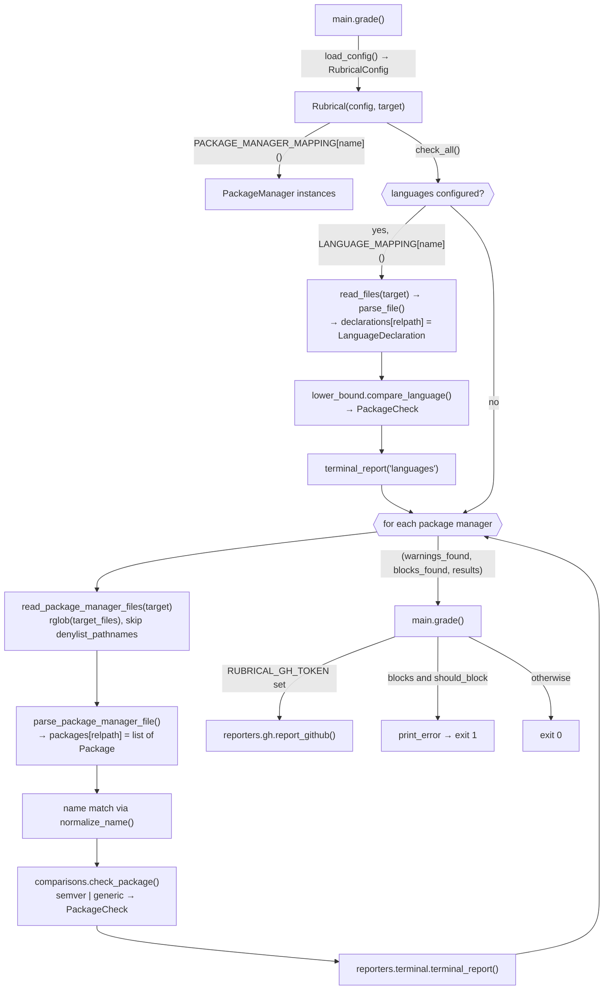

# Rubrical internals

Rubrical is a Typer CLI that scans a repository for dependency manifests, compares each declared dependency version constraint and each declared language version against `warn`/`block` thresholds from a config file, and reports results to the terminal and, optionally, to a GitHub PR comment.

## Layout

| Path | Role |
|------|------|
| `rubrical/main.py` | Typer `app`. `grade` command plus the mounted `configs` sub-app. Entry point is `rubrical = rubrical.main:app`. |
| `rubrical/subcommands/configs.py` | `configs validate` and `configs jsonschema`. |
| `rubrical/rubrical.py` | `Rubrical` orchestrator, `PACKAGE_MANAGER_MAPPING` and `LANGUAGE_MAPPING` (config name → class). |
| `rubrical/package_managers/` | `BasePackageManager` ABC plus one subclass per ecosystem (`go`, `jsonnet`, `nodejs`, `python`). |
| `rubrical/languages/` | `BaseLanguage` ABC plus one subclass per language (`go`, `nodejs`, `python`). Each extracts at most one `LanguageDeclaration` per file. See [ADR 0003](../adrs/0003-language-version-checks.md). |
| `rubrical/comparisons/` | `check_package()` dispatches on `PackageRequirement.type` to `semversion` or `string`. `lower_bound.py` grades language declarations. |
| `rubrical/reporters/` | `terminal.py` renders a Rich table. `gh.py` upserts or deletes a PR comment through PyGithub. |
| `rubrical/schemas/` | `configuration.py` holds the Pydantic config models. `package.py`, `language.py` and `results.py` hold the internal dataclasses. |
| `rubrical/enum.py` | All enums: `SupportedPackageManagers`, `SupportedLanguages`, `VersionDialect`, `DependencySpecifications`, `PackageCheck`, `PackageTypes`, `SemverComparison`. |
| `rubrical/utilities/console.py` | `rich.print` wrappers. `print_error` raises `typer.Exit(1)` (typed `NoReturn`). |
| `rubrical/utilities/config.py` | `load_config(path)`, shared by `grade` and `configs validate`. Exits 1 on a `ValidationError`. |
| `rubrical/utilities/files.py` | `find_files()` (`rglob` plus the substring denylist) and `FileDetails`, shared by package managers and languages. `PackageManagerFileDetails` is an alias of `FileDetails`. |

## Flow of `rubrical grade`

## Core data model

- **Config** (Pydantic, `schemas/configuration.py`): `RubricalConfig{version, blocking_mode, languages[] = [], package_managers[] = []}`. `PackageManager{name: SupportedPackageManagers, packages[]}` → `PackageRequirement{name, type=semver|generic, warn, block}`. `LanguageRequirement{name: SupportedLanguages, warn, block}`; each language may appear once. The config is loaded from `.yaml`, `.json`, or `.toml` with `benedict`.
- **Parsed dependency** (dataclass, `schemas/package.py`): `Package{name, raw_constraint, version_constraints: [Specification{version, specifier: DependencySpecifications}]}`. A single dependency can carry several specifications, such as `>=1.0,<2`.
- **Language declaration** (dataclass, `schemas/language.py`): `LanguageDeclaration{version, raw_constraint, dialect: VersionDialect}`. `version` is the declared range (`>=3.7`); `raw_constraint` is what reports show (`requires-python ">=3.7"`).
- **Result** (dataclass, `schemas/results.py`): `PackageCheckResult{name, file, check: PackageCheck, version_package, version_warn, version_block}`.
- `PackageCheck` has four values: `OK`, `WARN`, `BLOCK`, and `NOOP`. `NOOP` means the constraint can't be judged, for example a lower bound only.

## Package manager pattern

Each subclass of `BasePackageManager`:

1. Sets the class attributes `target_files` (glob names) and, optionally, `denylist_pathnames`, which are substring-matched against the path.
2. Sets `self.name = SupportedPackageManagers.X.value` in `__init__`.
3. Optionally extends `self.specification_symbols` with a dict merge (`|`) to map ecosystem operators. Python adds `~=`→`APPROX_EQ`. NodeJS adds `~`→`APPROX_EQ` and `^`→`COMPATIBLE`.
4. Implements `parse_package_manager_file(details)`, which must initialize and fill `self.packages[details.name]`. `details.name` is the file path relative to `--target`.
5. Optionally overrides `normalize_name(name)`. It is applied to both the config name and the parsed name before matching. The default keeps names exact; Python applies PEP 503 rules (lowercase, with runs of `-`, `_` and `.` treated as `-`).

`match_from_specification_symbols(version)` finds the specifier by substring match. The last matching group wins, so `>=` resolves to `GTE` rather than `GT`. The function then strips the operator characters. If nothing matches, the specifier defaults to `EQ`.

| Manager | Files | Parsing notes |
|---------|-------|---------------|
| `go` | `go.mod` | Regex over `( … )` blocks. Lines containing `indirect` are skipped. Every entry is `EQ`. |
| `jsonnet` | `jsonnetfile.json` | Pydantic models for the file. The name comes from `git.repository_from_url(remote)` as `owner/repo`. The version (which may be a branch) is `EQ`. |
| `python` | `requirements.txt`, `pyproject.toml` | `requirements-parser` for each line. In `pyproject.toml`, PEP 621 `project.dependencies` are re-parsed through `requirements.parse`. Poetry (`tool.poetry`) goes through `requirements_detector.find_requirements(parent_dir)`. Requirements with no version specifier are dropped. |
| `nodejs` | `package.json` (skips `node_modules`) | Reads `dependencies`, `devDependencies`, and `peerDependencies`. Whitespace between an operator and its version is removed first (`>= 1.2.3` → `>=1.2.3`), and runs of whitespace between comparators are collapsed. Partial versions and X-ranges (`1`, `1.2`, `1.x`, `1.x.x`, `1.2.*`) become `APPROX_EQ`. `a - b` becomes `GTE`+`LTE`. Two-part `>=a <b` is parsed per part. `\|\|` and other multi-part ranges are skipped. |

## Language pattern

Each subclass of `BaseLanguage` sets `target_files`, optionally `denylist_pathnames`, sets `self.name = SupportedLanguages.X.value`, and implements `parse_file(details) -> Optional[LanguageDeclaration]`. Returning `None` means the file declares no version, and it produces no result.

| Language | Files | Declaration | Dialect |
|----------|-------|-------------|---------|
| `go` | `go.mod` | The `go` directive. Without one, `go 1.16 (implicit)`, as the Go toolchain assumes. `toolchain` is ignored. | `GO` |
| `python` | `pyproject.toml` (skips `.venv`, `node_modules`) | `project.requires-python`, else `tool.poetry.dependencies.python`. | `PEP440` / `POETRY` |
| `nodejs` | `package.json` (skips `node_modules`) | `engines.node`. | `NPM` |

## Comparison semantics (`comparisons/`)

- **semver** (default): each `Specification` reduces to the highest version the constraint allows, which is then compared against the thresholds:
  - `EQ`, `LT`, and `LTE` use the version as-is.
  - `GT`, `GTE`, and `NE` give `NOOP`.
  - `APPROX_EQ` pads missing components with `999999`, so `1.2` becomes `1.2.999999`.
  - `COMPATIBLE` replaces the last component with `999999` and pads, so `6.0.1` becomes `6.0.999999`.

  A leading `v` is stripped. The result is `BLOCK` if the version is below `block`, otherwise `WARN` if it is below `warn`, otherwise `OK`. A `ValueError` from `semver` (an unparseable version) gives `OK`. For a package with several specifications, `max_status` picks the most severe in the order `BLOCK > WARN > OK > NOOP`.
- **generic**: applies only when there is exactly one `EQ` specification; anything else gives `NOOP`. It uses a plain lexicographic string comparison (`warn > version`, `block > version`).
- **Language lower bound** (`lower_bound.py`): languages are graded by the *lowest* `MAJOR.MINOR.PATCH` their declaration allows, because language declarations are minimums. The rules per dialect, with sources, are in [the plan](plans/language-version-checks.md#verified-syntax-rules).
  - Whitespace after an operator is removed. Within AND-ed comparators the highest lower bound applies; across `||` alternatives the lowest applies.
  - Versions are padded to three parts and pre-release/post/dev/build suffixes are dropped (`1.21rc1` → `1.21.0`).
  - `>X` differs by dialect: PEP 440 and Poetry give the next patch (`>3.9` → `3.9.1`); npm increments the last given part (`>1.2` → `1.3.0`, `>1.2.3` → `1.2.4`).
  - `lower_bound()` raises `UngradeableError` when there is no lower bound (`*`, `<3.12`) or the syntax is invalid in the dialect (`^` in PEP 440). `compare_language()` turns that into `NOOP`, never `OK`, and returns a `LanguageGrade` whose `reason` is logged with `--debug`.

## Reporting

- **Terminal**: one table per manager, plus a `languages` table when languages are configured, listing only `WARN` and `BLOCK` results and printed only when there is at least one. Otherwise a single success line is printed.
- **Result keys**: `check_all()` returns results keyed by `languages` (only when configured, first) and then by package manager name. Both reporters loop over the keys. Language blocks and warnings count toward the exit status like dependency ones.
- **Exit status**: `should_block` is the `--block/--no-block` flag when given, otherwise `blocking_mode` from the config (default `true`). Blocks with `should_block` exit 1. Blocks without it print a "blocking is disabled" header and exit 0.
- **GitHub**: enabled when `RUBRICAL_GH_TOKEN` is set. It also needs `RUBRICAL_REPOSITORY` and `RUBRICAL_PR_ID`, and optionally `RUBRICAL_GH_CUSTOM_URL` (which uses `<url>/api/v3`) and `RUBRICAL_REPORT_ID` (`--report-id`). `|` in a declaration is escaped as `\|` so `||` ranges stay in their table cell. If there are warnings or blocks, the comment is edited or created. If the run is clean, any old comment is deleted. Comments are matched within a scope ([ADR 0002](../adrs/0002-github-report-id.md)):
  - **With a report ID**: comments that start with `<!-- rubrical:report-id=<id> -->` (a comment that only quotes the marker further down is ignored). Duplicates converge: the oldest match is kept and the rest are deleted.
  - **Without a report ID (legacy)**: comments containing `[Rubrical](https://github.com/ivanklee86/rubrical) Report` and no report-ID marker. The last match is used and any others are left alone, as before.
  - In both scopes, a 404 on `edit()` (the comment was deleted concurrently) falls back to creating a new comment, and a 404 on `delete()` counts as done. Every comment ID found, created, edited or deleted is logged through the `rubrical.reporters.gh` logger.

## Common changes

**Add a package manager**
1. Add a value to `SupportedPackageManagers` in `enum.py`.
2. Create `package_managers/<name>.py` that subclasses `BasePackageManager`.
3. Register the class in `PACKAGE_MANAGER_MAPPING` in `rubrical.py`.
4. Add fixtures under `tests/files/<name>/` and a test in `tests/unit/package_managers/`. Add entries to `tests/files/rubrical*.yaml` if integration coverage is wanted.

**Add a language**
1. Add a value to `SupportedLanguages` in `enum.py`, and to `VersionDialect` if its version syntax is new (then add a comparator and an alternatives splitter to `DIALECTS` in `comparisons/lower_bound.py`, following the official spec).
2. Create `languages/<name>.py` that subclasses `BaseLanguage`.
3. Register the class in `LANGUAGE_MAPPING` in `rubrical.py`.
4. Add fixtures under `tests/files/`, parser cases to `tests/unit/comparisons/test_lower_bound.py`, a test in `tests/unit/languages/`, and expected results to `tests/files/rubrical-languages.yaml` and `test_rubrical_languages`.

**Add a comparison type**
1. Add a value to `PackageTypes`.
2. Create a module in `comparisons/` that returns `PackageCheck`. Use `utils.results_to_status` and `utils.max_status`.
3. Add a branch for it in `comparisons/__init__.check_package`.

## Dev workflow

- Tooling is `uv` and [Task](https://taskfile.dev). The commands are:
  - `task python:install`
  - `task python:fmt`, which runs `ruff format` and `ruff check --fix`
  - `task python:lint`, which runs `ruff` and `ty check`
  - `task python:test`, which runs `pytest tests/unit tests/integration`
  - `task docs:test`, which runs `mkdocs build --strict`
- Tests use fixture repos in `tests/files/`. Unit tests instantiate a manager, then call `read_package_manager_files(path)` and `parse_package_manager_files()`, then assert on `.packages[relpath]`. Integration tests drive `main.app` through `typer.testing.CliRunner` with `--target tests/`. The GitHub reporter's logic is unit tested offline in `tests/unit/reporters/test_gh.py` against an in-memory fake of PyGithub. Live GitHub tests are marked `github`, need `RUBRICAL_TEST_GITHUB_ACCESS_TOKEN` (without it they skip, and `-rs` lists them), and target PR #27 of `ivanklee86/rubrical`. They use the `github_report` fixture in `tests/fixtures.py`, which gives each test a unique report ID (`test-<run id>-<attempt>-<test>-<random>`), so concurrent CI runs never touch each other's comments. The fixture deletes only that test's comments at teardown, and at setup it sweeps `test-` comments older than 6 hours that were left by cancelled runs. Run `pytest -o log_cli=true -m github` to watch the comment IDs each test touches.
- The version comes from `setuptools_scm` and is written to `rubrical/_version.py`, which is untracked. The Docker image (`Dockerfile`) uses `ENTRYPOINT ["rubrical", "grade"]`.

## Known quirks

- Unparseable semver versions (such as branch names) are treated as `OK`, not `NOOP`. Language checks don't share this quirk.
- `go.mod`, `pyproject.toml` and `package.json` are read twice when both a package manager and a language are configured.
- Package names are matched exactly for every manager except Python, so a capitalization difference in a Node.js, Go or Jsonnet name won't match.
