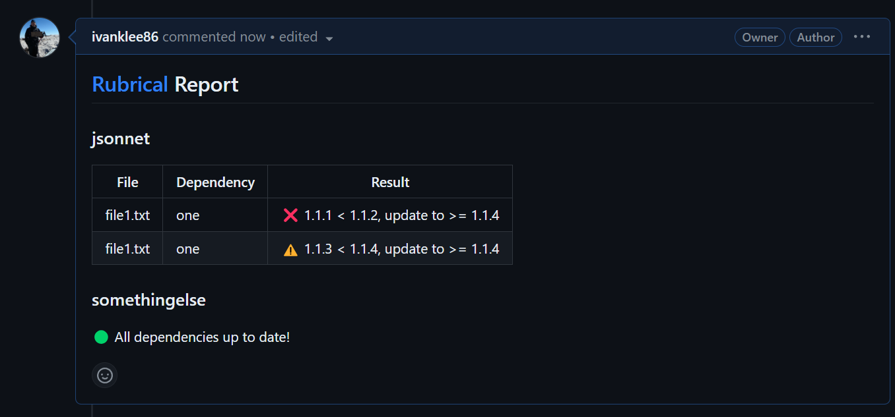

## Terminal

Comes for free!  An example can be seen below:


## Github

1. Create a Github access token with `Pull requests: Read and write` permissions to your repositories.
2. Run rubrical with the `--gh-access-token`, `--repository-name`, and `--pr-id` flags.

`rubrical` will report status on comments to the PR if violations are found.  It's also a good citizen - if no violations are found, it will clean up after itself!



### Several reports on one PR

By default, rubrical keeps one comment per PR, so two rubrical runs on the same PR (for example, one per service in a monorepo, each with its own config) overwrite each other's comment. Give each run its own `--report-id` (or `RUBRICAL_REPORT_ID`) to keep a separate comment for each one:

```console
rubrical grade --config services/api/rubrical.yaml --target services/api --report-id api ...
rubrical grade --config services/web/rubrical.yaml --target services/web --report-id web ...
```

A report ID is 1-100 characters of letters, digits, `.`, `_`, `/` or `-`. It's stored in a hidden marker in the comment and shown in the comment's heading. A run with a report ID only updates or deletes comments with the same ID. If it finds more than one (for example, after two runs raced each other), it keeps one and deletes the rest. A run without a report ID leaves comments with report IDs alone.
